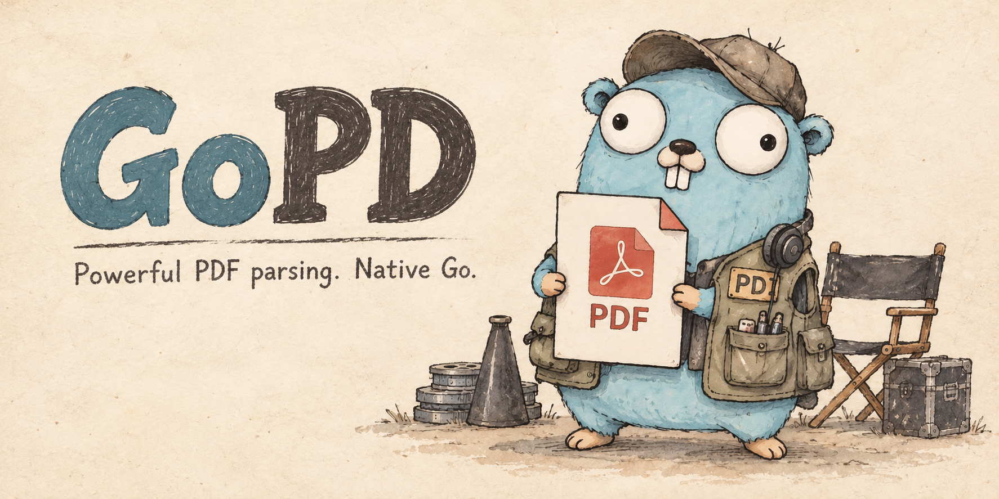

**Go 네이티브로 작성된 파워풀한 PDF 파서**

[English](README.md) | 한국어

## 제작 배경

Go 생태계에서는 MuPDF처럼 강력한 오픈소스 PDF 파서를 찾기 어려웠습니다. 다른 언어로 작성된 DLL을 불러와 사용하는 프로젝트가 많았고, 저는 이런 방식이 아름답지 않다고 생각했습니다.

Go 네이티브로 작성된 프로젝트 중에는 상업적으로 사용되는 프로젝트도 있었습니다. 하지만 저는 그 점이 마음에 들지 않았습니다.

이 프로젝트는 MuPDF를 참고했습니다.

## 필요한 콘텐츠만 추출하기

`ParseFile`은 요청한 종류의 결과만 생성합니다. 빈 옵션은 Unicode 텍스트와 기본 글꼴 정보를 페이지별로 반환합니다.

```go
package main

import (
    "fmt"
    "log"

    "github.com/MyungSub0519/gopd"
)

func main() {
    result, err := gopd.ParseFile("testdata/synthetic.pdf", gopd.ParseOptions{})
    if err != nil {
        log.Fatal(err)
    }
    for _, page := range result.Pages {
        for _, text := range page.Texts {
            fmt.Println(page.Index+1, text.Unicode)
        }
    }
}
```

`ContentText`, `ContentGraphics`, `ContentImages`, `ContentAnnotations`를 `|`로 조합하거나 `ContentAll`을 선택합니다. 상세 수준은 별도의 `Detail` 옵션으로 지정합니다. `ParseReader`는 `io.ReaderAt`과 입력 크기를 받으며 두 진입점 모두 `*gopd.Result`를 반환합니다.

| 상세 수준 | 반환 정보 |
| --- | --- |
| `DetailBasic` (기본값) | 선택한 콘텐츠와 기본 글꼴 정보 |
| `DetailLayout` | 기본 정보 + 텍스트·이미지 위치와 그리기 스타일 |
| `DetailFull` | 배치 정보 + 글리프·연산자·원본 출처와 `Result.Details()` |

```go
result, err := gopd.ParseFile("file.pdf", gopd.ParseOptions{
    Content: gopd.ContentText | gopd.ContentImages,
    Detail:  gopd.DetailFull,
})
if result != nil {
    defer result.Close() // 오류와 함께 반환된 부분 결과도 닫습니다.
}
if err != nil {
    return err // result는 부분 결과일 수 있습니다.
}
detail := result.Details() // 선택한 콘텐츠의 상세 결과. 다시 파싱하지 않습니다.
_ = detail
```

기존 `Positions`, `Styles`, `Glyphs`, `Provenance` 필드는 `Detail`로 대체되었습니다. 기존 호출 코드는 위치·스타일이 필요하면 Layout, 글리프·출처가 필요하면 Full로 변경해야 합니다. 고정된 레벨이므로 이전의 임의 조합보다 더 많은 정보를 처리할 수 있습니다. [레벨별 계약과 마이그레이션](docs/detail-levels.md)을 참고하세요.

선택한 종류는 콘텐츠 순회기를 공유합니다. 미선택 콘텐츠의 결과는 생성하지 않으며 Full에서만 입력 Document를 보관합니다. Full의 `Details()`는 선택한 상세 요소·글꼴 리소스·그래픽 상태·그리기 순서를 제공합니다. 다른 레벨에서는 nil입니다. Full도 미선택 콘텐츠를 활성화하지 않으며 PDF 전체 지원이나 렌더링을 의미하지 않습니다. 원본 입력은 기본 64 KiB 버퍼로 필요한 범위만 읽으며 `ReadOptions.BufferSize`로 크기를 지정할 수 있습니다. 디코딩된 스트림과 결과에는 기존 메모리 예산이 적용됩니다. 전체 메모리 사용량 제한이나 건너뛴 콘텐츠의 전체 유효성 검사를 보장하지 않습니다.

리소스 제한은 `ParseOptions.ReadOptions`로 설정합니다. 그래픽의 경로와 주석의 사각형은 항상 포함됩니다. 결과는 회전을 적용하지 않은 PDF 사용자 좌표계와 그리기 순서를 사용하며, 읽기 순서를 복원하지 않습니다.

새 코드에는 `ParseFile` / `ParseReader`를 사용합니다. `ParsePDF`, `Open`, `Read`는 기존 반환 타입과 결과 데이터를 유지하지만 반환값의 `Close` 호출이 필요한 호환 API입니다. 객체·바이트·구문을 직접 다루는 `LoadDocument`, `ReadDocument`, `BuildPDF`, `Lex`, `ParseObject`도 계속 `gopd`에서 사용할 수 있습니다.

부분 결과가 반환되어도 항상 오류를 확인하고, 미지원 해석은 진단 정보도 확인합니다. 반환값은 읽기 전용으로 취급합니다. Full 결과·기존 API 결과·저수준 Document는 사용을 마치면 `Close`로 닫으며 오류와 함께 반환된 부분 결과도 닫습니다. Basic과 Layout은 반환 전에 내부 Document를 닫습니다. Document를 닫을 때까지 입력을 열린 상태로 유지하고 변경하지 않아야 합니다. `Document`의 지연 메서드와 `Close`는 동시 호출을 지원하지 않습니다. Reader API는 전달받은 reader를 닫지 않습니다. `Close` 이후에도 생성된 결과 데이터는 사용할 수 있지만 원본 출처 접근은 사용할 수 없습니다. 선택 추출 결과는 `json.Marshal(result)`로 저장할 수 있으며 미선택·빈 필드는 생략될 수 있습니다. `Document`와 내부 상세 결과는 항상 JSON에서 제외되지만 Full의 페이지 연산자는 포함됩니다.
상세 선언은 [api.go](api.go), [types.go](types.go), 실행 가능한 예제는 [example_test.go](example_test.go)를 참고하세요.

CLI는 `go run ./cmd/gopd -text file.pdf`로 실행합니다. `-json`은 개수 요약, `-layout`은 좌표로 재구성한 줄을 출력합니다.

## 지원 기능

GoPD는 PDF에 담긴 콘텐츠와 그 콘텐츠를 구성하는 내부 구조까지 정밀하게 해석하는 것을 목표로 합니다.

- **텍스트** — 문자열뿐 아니라 글자 단위의 문자 코드, Unicode 매핑, 글꼴, 크기, 위치와 변환 정보를 분석합니다.
- **벡터 그래픽** — 선과 베지어 곡선으로 구성된 경로, 윤곽선과 채우기, 색상, 선 두께, 점선과 클리핑 정보를 분석합니다.
- **이미지** — 이미지의 원본 스트림, 해상도, 색 공간, 마스크 여부와 페이지에 배치되는 위치·크기·회전을 분석합니다.
- **콘텐츠 실행 구조** — 텍스트·그래픽·이미지의 그리기 순서와 상태 변화, 중첩된 Form XObject의 호출 관계를 추적합니다.
- **파일 내부 구조** — PDF 객체와 간접 참조, 압축된 객체 스트림, xref 테이블·스트림과 증분 갱신 연결 구조를 분석합니다.
- **원본과의 연결** — 해석 결과에서 해당 요소를 만든 명령과 객체, 원본 또는 디코딩된 데이터의 바이트 범위까지 추적할 수 있도록 합니다.

현재는 이 목표의 일부를 구현한 단계이며, 복잡한 색 공간·투명도 효과, 암호화된 콘텐츠 등의 해석에는 제한이 있습니다. 인라인 이미지와 이미지 XObject는 위치와 메타데이터만 제공하며 픽셀로 디코딩하지 않습니다.

현재 처리 범위와 제한 설정은 [리소스 제한 문서](docs/resource-limits.md)를 참고하세요.
개발 검증 절차는 [기여 안내](CONTRIBUTING.md)를 참고하세요.

구현과 리뷰에는 [PDF 표준 구현 지침](docs/pdf-spec-conformance.md)을 적용합니다.
초기 기준은 PDF 1.7 / ISO 32000-1:2008이며, Adobe 확장과 PDF 2.0은 별도로 관리합니다.

## 프로젝트 구조

루트 패키지는 공개 API와 타입 별칭을 제공합니다. 콘텐츠 해석·선택 추출·결과 모델은 `internal/parser`에, 공통 PDF 모델·구문 분석·문서 읽기·테스트 입력 생성기는 각각 `internal/pdfmodel`, `internal/syntax`, `internal/document`, `internal/pdftest`에 있습니다. CLI는 `cmd/gopd`에 있습니다.
