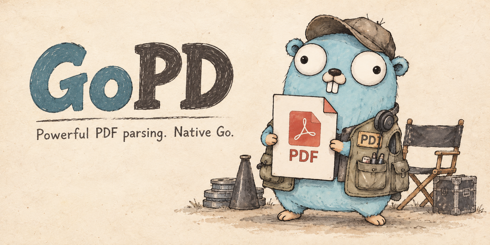

**A powerful PDF parser written in native Go.**

English | [한국어](README.ko.md)

## Motivation

I struggled to find an open-source PDF parser as powerful as MuPDF in the Go ecosystem. Many projects relied on importing DLLs written in other languages, and I did not find that approach elegant.

There were also native Go projects used commercially, but I was not happy with that either.

This project draws on MuPDF as a reference.

## Parse selected content

Use `ParseFile` to generate only the content you need. Zero options return Unicode
text and compact font metadata, grouped by page.

```go
package main

import (
    "fmt"
    "log"

    "github.com/MyungSub0519/gopd"
)

func main() {
    result, err := gopd.ParseFile("testdata/synthetic.pdf", gopd.ParseOptions{})
    if err != nil {
        log.Fatal(err)
    }
    for _, page := range result.Pages {
        for _, text := range page.Texts {
            fmt.Println(page.Index+1, text.Unicode)
        }
    }
}
```

Combine `ContentText`, `ContentGraphics`, `ContentImages`, and
`ContentAnnotations` with `|`, or select `ContentAll`. Independently choose a
fixed `Detail` level. `ParseReader` accepts an `io.ReaderAt` and input size;
both entry points always return `*gopd.Result`.

| Detail | Information |
| --- | --- |
| `DetailBasic` (default) | Selected content and compact font metadata |
| `DetailLayout` | Basic information plus text/image positions and paint styles |
| `DetailFull` | Layout information plus glyphs, operations, source spans and `Result.Details()` |

```go
result, err := gopd.ParseFile("file.pdf", gopd.ParseOptions{
    Content: gopd.ContentText | gopd.ContentImages,
    Detail:  gopd.DetailFull,
})
if result != nil {
    defer result.Close() // Also release partial results.
}
if err != nil {
    return err // result may be partial
}
detail := result.Details() // selected detailed content; no second parse
_ = detail
```

`Detail` replaces the former `Positions`, `Styles`, `Glyphs`, and `Provenance`
fields. Existing callers must migrate to Layout for positions/styles or Full
for glyphs/provenance. See [detail levels and migration](docs/detail-levels.md).

Selected kinds share the content interpreter. Unrequested results are not
constructed, and the result retains the input Document only at `DetailFull`.
Full also keeps selected detailed elements, font resources, graphics state and
drawing order through `Details()`; other levels return nil from that method.
Full does not enable unselected content or imply complete PDF support or rendering.
Original input is read on demand through a 64 KiB buffer, configurable with
`ReadOptions.BufferSize`. Decoded streams and results keep their existing memory
budgets; this does not bound total memory or fully validate skipped content.

`ParseOptions.ReadOptions` configures resource limits. Graphics always include
path geometry, and annotations include their rectangles. Results follow drawing
order in unrotated PDF user coordinates, not reconstructed reading order.

Use `ParseFile` / `ParseReader` for new code. `ParsePDF`, `Open`, and `Read`
remain compatibility APIs with their previous return types. `LoadDocument`,
`ReadDocument`, `BuildPDF`, `Lex`, and `ParseObject` remain available in `gopd`
for low-level object, byte and syntax access.

Always check errors, even with a non-nil partial result, and inspect diagnostics
for unsupported interpretation. Treat results as read-only. Close Full results,
legacy results and low-level Documents when finished, including partial results.
Basic and Layout close their internal Document before return. Keep retained input
open and unchanged until Close. Lazy `Document` methods and Close are not safe
for concurrent calls. Reader APIs never close caller-owned readers. Materialized
output remains usable after Close; source access does not.
`json.Marshal(result)` serializes selected results;
unselected or empty fields may be omitted. `Document` and the private detailed
view are excluded; Full page operations are included.
See [api.go](api.go), [types.go](types.go), and the runnable [example](example_test.go).

For CLI inspection, run `go run ./cmd/gopd -text file.pdf`. Use `-json` for counts
or `-layout` for text reconstructed into visual lines.

## Supported Features

GoPD aims to provide detailed interpretation of PDF content and the internal structures that define it.

- **Text** — Analyze not only strings but also individual character codes, Unicode mappings, fonts, sizes, positions, and transformations.
- **Vector graphics** — Analyze paths made of lines and Bézier curves, strokes and fills, colors, line widths, dash patterns, and clipping information.
- **Images** — Analyze original image streams, pixel dimensions, color spaces, image mask status, and placement positions, sizes, and rotations on the page.
- **Content execution structure** — Track the drawing order of text, graphics, and images, state changes, and nested Form XObject calls.
- **Internal file structure** — Analyze PDF objects and indirect references, compressed object streams, xref tables and streams, and the chain of incremental updates.
- **Source traceability** — Trace interpreted elements back to the commands and objects that produced them, down to byte ranges in the original or decoded data.

These goals are partially implemented. Interpretation of complex color spaces, transparency effects, and encrypted content remains limited. Inline and XObject images are located and described but not decoded.

See [resource limits and interpretation](docs/resource-limits.md) for the current
processing contract and [contributing](CONTRIBUTING.md) for development checks.

Implementation and review follow the [PDF specification conformance guidelines](docs/pdf-spec-conformance.md)
(Korean), with PDF 1.7 / ISO 32000-1:2008 as the initial baseline and separate
tracking for Adobe extensions and PDF 2.0.

## Project structure

The root package exposes the public API. Content interpretation, extraction, and
result models live in `internal/parser`. Shared PDF models, syntax, document
reading, and test fixtures live in `internal/pdfmodel`, `internal/syntax`,
`internal/document`, and `internal/pdftest`. The CLI lives in `cmd/gopd`.
